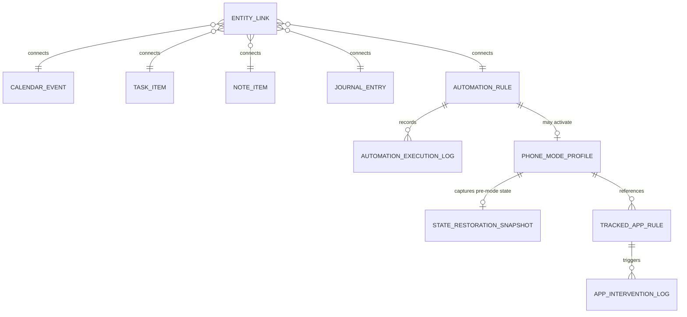

# Nestin Local Database & Storage Schema

Nestin stores all user data locally on-device using `StorageService` (`lib/data/services/storage_service.dart`) over `SharedPreferences` JSON documents (`version: 3` backup envelope) plus atomic snapshot protection for money ledger writes.

---

## 1. Storage Keys & Models

### Roo (Time & Planning)
| Key | Model | Notes |
| :--- | :--- | :--- |
| `nestin_alarms_v1` | `Alarm` | ID, label, hour/minute, weekdays, category, volume/ramp, challenge profile, snooze config. |
| `nestin_reminders_v1` | `Reminder` | ID, title, notes, `dueDateTime`, `ReminderRecurrence`, category, completion status. |
| `nestin_timers_v1` | `CountdownTimer` | Concurrent countdown presets and remaining state. |
| Preserved events / tasks / routines | `CalendarEvent`, `TaskItem`, `RoutineItem`, `FocusSessionLog` | Subtasks (`TaskSubItem`), routine steps & streaks, optional `hasDepartureHeadsUp`. |

### Echo (Journal & Memories)
| Key | Model | Notes |
| :--- | :--- | :--- |
| Journal & Memories lists | `JournalEntry`, `MemoryItem` | Entry metadata, mood, gratitude note, privacy lock hash/override flags (`UserPreferences`). |

### Seren (Personal Wellness)
| Key | Model | Notes |
| :--- | :--- | :--- |
| Medications | `MedicationItem`, `MedicationLog`, `MedicationSnooze` | Dose instructions, units, inventory count, deterministic FNV-1a notification IDs. |
| Hydration & Sleep & Caffeine & Health | `HydrationData`, `BedtimeWindDownConfig`, `SleepLog`, `CaffeineEntry`, `CaffeineConfig`, `DailyHealthActivity`, `VitalLog`, `HealthGoals` | Daily history maps (`YYYY-MM-DD`), 90m REM settings, step/vital logs. |

### Pippin (Personal Interests)
| Key | Model | Notes |
| :--- | :--- | :--- |
| Hobbies & Reading | `HobbyItem`, `HobbyPracticeSession`, `ReadingItem` | Practice durations, categories, milestones, book page progress. |

### Twill (Notes, Organization & Simple Money)
| Key | Model | Notes |
| :--- | :--- | :--- |
| Notes & Lists | `NoteItem`, `CollectionItem`, `WishlistItem` | Markdown checklist helpers, pin/archive states, target prices. |
| `nestin_money_schema_version` (`1`), `nestin_money_settings_v1`, `nestin_money_*_v1` | `MoneyAccount`, `MoneyCategory`, `MoneyTransaction`, `MoneyBudget`, `RecurringTransaction`, `MoneySettings` | Integer minor units (`amountMinor`) avoid float rounding; `commitMoneyLedgerAtomically` rolls back all 3 keys on failure. |

### Scout (Context, Wellbeing, Modes, Permissions, Automations & Links)
| Key | Model | Contents |
| :--- | :--- | :--- |
| Saved Places, Geofences, Departures | `SavedPlace`, `LocationReminder`, `GeofenceTriggerLog`, `DeparturePreset`, `DepartureEvent` | Haversine radius, cooldown windows, active preset state. |
| `nestin_tracked_app_rules_v1` | `List<TrackedAppRule>` | `id`, `displayName`, `packageName`, `dailyLimitMinutes`, `warningThresholdPercent`, `WellbeingInterventionLevel`, schedule window. |
| `nestin_app_intervention_logs_v1` | `List<AppInterventionLog>` | Capped at 150 recent entries (`reason`, `outcome`, `level`, `timestamp`). |
| `nestin_phone_mode_profiles_v1` | `List<PhoneModeProfile>` | `Sleep`, `Work`, `Study`, `Relax`, `Custom` profiles (`enableDnd`, brightness %, timeout sec, restricted app IDs, duration). |
| `nestin_active_phone_mode_id_v1` | `String?` | Active mode identifier across app restarts. |
| `nestin_state_restoration_snapshot_v1` | `StateRestorationSnapshot?` | Pre-mode raw DND filter, raw brightness (`0..255`), raw screen timeout (`ms`), `modifiedByNestin` flags, `applied*` values, `expiresAt`. |
| `nestin_permission_history_v1` | `List<PermissionEntry>` | Persisted permission grant history enabling revoked-permission detection after OS/user changes. |
| `nestin_automation_rules_v1` | `List<AutomationRule>` | Trigger, conditions, actions, priority (`1..100`), confirmation flag, retry policy. |
| `nestin_automation_logs_v1` | `List<AutomationExecutionLog>` | Capped at 200 entries; tracks `AutomationExecutionStatus`, attempt count, rollback eligibility. |
| `nestin_entity_links_v1` | `List<EntityLink>` | Bidirectional typed link edges (`sourceType`, `sourceId`, `sourceTitle`, `targetType`, `targetId`, `targetTitle`, `relationship`, `createdAt`). |

---

## 2. Entity Relationship Overview

